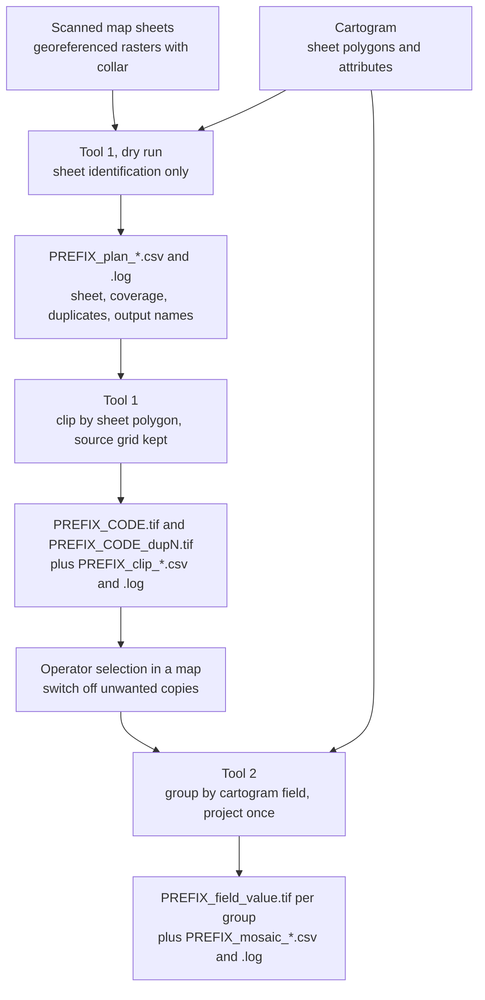
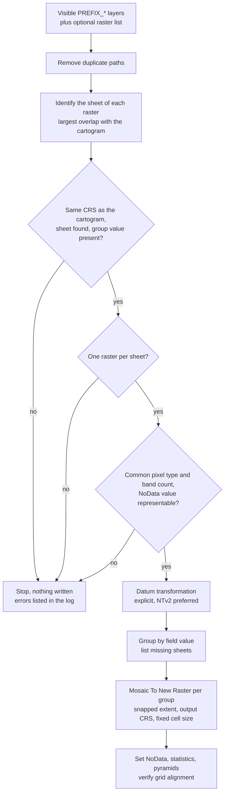

# Map Sheet Mosaic

> Collar removal and map-level mosaicking of scanned, georeferenced map sheets in ArcGIS Pro

[](https://opensource.org/licenses/Apache-2.0)
[](https://www.esri.com/en-us/arcgis/products/arcgis-pro/overview)
[](https://www.python.org)
[](https://github.com/PedroMMGoncalves/mapsheet-mosaic-arcgis-tools/actions/workflows/ci.yml)
[](CHANGELOG.md)

Map Sheet Mosaic is an ArcGIS Pro Python toolbox (`MapSheetMosaic.pyt`) for
archives of scanned map sheets that have already been georeferenced. It has
two tools. **Tool 1** identifies the sheet covered by each raster from its
georeferencing, removes the collar (the area outside the neat line) with the
sheet polygon of a cartogram, and names the result by sheet code. **Tool 2**
mosaics one operator-selected copy of each sheet, grouped by any cartogram
attribute (typically the parent map sheet at a smaller scale), directly into
the target coordinate system, so that projection and mosaicking share a
single resampling step.

The code makes no assumption on sheet size, map scale, file naming, band count
or pixel type: these are taken from the cartogram, the tool parameters and
the rasters. The toolbox was developed at LNEG for the processing of scanned
map-sheet archives. The first test case is a collection of 1:5000 map sheets
from the magnetic surveys carried out by the Serviço de Fomento Mineiro (SFM).

See [`CHANGELOG.md`](CHANGELOG.md) for release notes.

## Contents

- [Workflow](#workflow)
- [Tools](#tools)
- [Method](#method)
- [Requirements](#requirements)
- [Installation](#installation)
- [Parameters](#parameters)
- [Output convention](#output-convention)
- [Default values](#default-values)
- [Tests](#tests)
- [Validation status](#validation-status)
- [Limitations](#limitations)
- [Troubleshooting](#troubleshooting)
- [Citation](#citation)
- [License](#license)
- [References](#references)

---

## Workflow

Tool 1 is run twice: first as a dry run that only writes the plan, then for
real. The choice between duplicate scans of the same sheet is made by the
operator in a map, by switching layers on or off; neither tool selects
copies automatically. Tool 2 reads that selection from the active map.



---

## Tools

### At a glance

| # | Tool | One-liner | Resampling | Writes rasters |
| --- | --- | --- | :---: | :---: |
| 1 | Clip and Rename Sheets | Identify sheet by georeferencing, remove collar, name by sheet code | none | yes (not in dry run) |
| 2 | Mosaic Sheets by Map | One mosaic per cartogram group, projected to the target coordinate system | once | yes |

### Detailed reference

| # | Tool | Purpose |
| --- | --- | --- |
| **1** | Clip and Rename Sheets | Lists raster files by extension in a folder tree (the output folder is excluded). For each raster: sheet identification by largest overlap with the cartogram, coverage in percent of the sheet area, extraction of a scan *variant* label from the file name, and an optional count of pixels that already carry the NoData value. Then clipping by the sheet polygon in the native coordinate system, without resampling. Duplicate scans receive `_dup1`, `_dup2`, ... in sorted input order. A dry run writes only the CSV plan and the log. Existing outputs are skipped, so an interrupted run can be resumed. |
| **2** | Mosaic Sheets by Map | Takes the raster layers visible in the active map whose file name starts with `PREFIX_` (a layer inside a hidden group layer counts as hidden), plus an optional list. Each input is identified again against the cartogram, so the tool does not depend on file names or on the CSV of Tool 1. Inputs are grouped by the value of a cartogram field and mosaicked with `Mosaic To New Raster` into the output coordinate system, with an explicit datum transformation when the datums differ. The output extent is snapped to multiples of the cell size and the grid alignment is verified after writing. Missing sheets per group are reported. |

### Input checks of Tool 2

Tool 2 evaluates all checks before writing anything and stops if any fails,
so that a selection error never produces a partial set of mosaics.



---

## Method

### Sheet identification

The footprint $`F`$ of a raster is its axis-aligned extent. Among the cartogram
polygons $`S_k`$ that intersect $`F`$, the sheet assigned is the one with the
largest area of intersection, and its coverage is expressed relative to the
sheet area:

```math
k^{\ast} = \arg\max_{k} A\left(F \cap S_k\right), \qquad
\mathrm{coverage} = 100 \cdot \frac{A\left(F \cap S_{k^{\ast}}\right)}{A\left(S_{k^{\ast}}\right)}
```

Identity therefore follows the georeferencing, not the file name; a misnamed
file is assigned to the sheet it actually covers. A raster with coverage below
the *Minimum sheet coverage* threshold is flagged `LOW_COVERAGE` but still
processed. Rasters and cartogram must share the coordinate system.

### Collar removal without resampling

Clipping uses the sheet polygon as clipping geometry with
`NO_MAINTAIN_EXTENT`, for which "the cell alignment of the input raster will
be maintained and the output extent will be adjusted accordingly" (Esri,
*Clip Raster*). Cell values are copied, not interpolated; cells outside the
neat line receive the NoData value in every band.

### Copy selection

Duplicate scans are frequent in map archives and differ in tone, contrast and
condition. Selecting a copy is a judgement on image quality, so it is left to
the operator. Tool 1 records the number of copies of each sheet (`n_copies`),
sets `use = 1` only for sheets with a single copy and state `OK`, and ends its
log with the list of sheets that have more than one copy, giving for each copy
its output name, variant, cell size and band count. Tool 2 accepts exactly one
raster per cartogram sheet: when a sheet has more than one, it lists every such
sheet with its rasters and writes nothing.

### Projection and mosaicking with a single resampling

Each pixel is resampled once, in `Mosaic To New Raster`, which writes directly
in the output coordinate system (default ETRS89 / PT-TM06, EPSG:3763) with
the selected resampling method and an explicit geographic transformation
(an NTv2 grid transformation is preferred when listed; Junkins and Farley,
1995). The output extent is the union of the input footprints projected to
the output coordinate system, snapped outward to multiples of the cell size
$`c`$:

```math
x'_{\min} = c \left\lfloor \frac{x_{\min}}{c} \right\rfloor, \qquad
x'_{\max} = c \left\lceil \frac{x_{\max}}{c} \right\rceil, \qquad
\text{and likewise for } y
```

Mosaics of neighbouring groups therefore share one grid. Because the
honouring of the extent environment is not assumed, the corner coordinates of
the written raster are checked after writing, and a warning is issued when

```math
\left| \frac{x}{c} - \mathrm{round}\left(\frac{x}{c}\right) \right| > 10^{-3}
\quad \text{for } x \in \lbrace X_{\min},\ Y_{\max} \rbrace
```

The cell size is fixed rather than derived from the inputs, so that all
mosaics of a collection share resolution and grid. Inputs with a coarser cell
are upsampled; this adds pixels but no information.

### Datum transformation: NTv2 grids for Portugal

The conversion from Lisboa Hayford-Gauss (Datum Lisboa) to ETRS89 / PT-TM06
involves a change of datum. Seven-parameter (Bursa-Wolf) transformations are
approximate, with errors of some metres, and do not model the distortions of
the classical geodetic network (Madeira, 2009). At 1:5000, 0.2 mm on the map
corresponds to 1 m on the ground, so errors of that size are visible at the
scale of the source documents. Grid-based transformations in NTv2 format
(Junkins and Farley, 1995) interpolate the coordinate differences between the
two datums observed at the points of the geodetic network.

For mainland Portugal, NTv2 grids were produced by J. A. Gonçalves
(Faculdade de Ciências da Universidade do Porto) from about 900 points of the
first- and second-order geodetic network with coordinates in ETRS89 and in the
local datums, interpolated by kriging (Madeira, 2009; OSGeo Wiki, 2014):

| Grid file | Transformation |
| --- | --- |
| `ptLX_e89.gsb` | Datum Lisboa → ETRS89 |
| `pt73_e89.gsb` | Datum 73 → ETRS89 |

A grid that is not available among the system transformations of ArcGIS Pro
can be registered with the *Create Custom Geographic Transformation* tool,
method `NTV2` (the procedure for ArcGIS Desktop is described by Madeira,
2009). Tool 2 fills its *Geographic transformation* list with
`ListTransformations` for the pair cartogram CRS → output CRS and preselects
the first name containing `NTv2`. Whether custom transformations are returned
by `ListTransformations` remains to be verified in ArcGIS Pro.

### NoData

One NoData value (default 0) is assigned to all bands. Since a source pixel
equal to that value would become NoData after clipping, Tool 1 can count, in
the sheet window $`W`$, the pixels $`p`$ that equal the NoData value $`v_0`$ in at
least one band $`b`$:

```math
n_{\mathrm{NoData}} = \left| \left\lbrace p \in W : \exists\ b,\ v_b(p) = v_0 \right\rbrace \right|
```

Cells that are already NoData in the source (e.g. corners of a rectified
scan) are read as a different value and are not counted. NoData is stored per
band, so a counted pixel loses only the affected band(s), which appears as a
hole or as a colour defect. No colour balancing is applied between scans.

---

## Requirements

- **ArcGIS Pro 3.0 or higher** (Windows), default Python environment
  (`arcgispro-py3`).
- `arcpy` and `numpy`, both bundled with ArcGIS Pro; Python standard library
  otherwise. **No additional packages.**
- All geoprocessing tools used (Clip Raster, Mosaic To New Raster, Set Raster
  Properties, Calculate Statistics, Build Pyramids) are Data Management tools
  available at every licence level. No extension is required.
- A polygon cartogram of the sheets with a sheet code field, in the same
  coordinate system as the georeferenced rasters.
- For datum transformations based on grid files that are not installed by
  default, the *ArcGIS Coordinate Systems Data* setup.

---

## Installation

1. Clone or download this repository.
2. Open **ArcGIS Pro**.
3. In the **Catalog** pane, right-click **Toolboxes** → **Add Toolbox**.
4. Select `MapSheetMosaic.pyt`.
5. The two tools appear under **Map Sheet Mosaic** in workflow order.

Tool 2 reads the current project (visible layers) and therefore runs in the
foreground.

---

## Parameters

### Tool 1, Clip and Rename Sheets

| Parameter | Description | Default |
| --- | --- | --- |
| Input raster folder | Folder containing the georeferenced scans | required |
| Include subfolders | Search the folder tree recursively | on |
| Raster file extensions | Extensions listed, separated by `;` | `.tif;.tiff` |
| Cartogram | Polygon layer of the sheets | required |
| Sheet code field | Field holding the sheet code used in output names | `COD_50255k` |
| Cartogram fields copied to the CSV | Optional attributes reported per raster | `Folha_25k;Folha_50k` |
| Output prefix | Prefix of output names (letters, digits, `_`, `-`) | required |
| Variant regular expression | Applied to the file name stem; the named group `var` is recorded as the scan variant | `^[^_]+_[^_]+_(?P<var>.+)$` |
| Output folder | Destination of rasters, CSV and log; must differ from the input folder | required |
| Minimum sheet coverage (%) | Below this value the state is `LOW_COVERAGE` | 99 |
| NoData value | Assigned to all bands of the clipped rasters | 0 |
| Count source pixels equal to NoData | Pixel check described in [NoData](#nodata) | on |
| Dry run | Write CSV and log only | on |

### Tool 2, Mosaic Sheets by Map

| Parameter | Description | Default |
| --- | --- | --- |
| Use raster layers visible in the active map | Visible raster layers whose file name starts with `PREFIX_` | on |
| Additional rasters | Optional explicit list of rasters | none |
| Cartogram | Polygon layer of the sheets | required |
| Sheet code field | Field holding the sheet code | `COD_50255k` |
| Group by field | Cartogram field defining the mosaics, one per value | `Folha_25k` |
| Output prefix | Prefix of input layers and output names | required |
| Output folder | Destination of mosaics, CSV and log | required |
| Output coordinate system | Target coordinate system | ETRS89 / PT-TM06 (EPSG:3763) |
| Geographic transformation | Filled from `ListTransformations` for cartogram CRS → output CRS, NTv2 preferred; empty when the datums are equal | automatic |
| Cell size | Output cell size in output coordinate system units | 0.4 |
| Resampling method | `BILINEAR`, `NEAREST` or `CUBIC`; also used for pyramids | `BILINEAR` |
| NoData value | Assigned to all bands of the mosaics; use the value of Tool 1 | 0 |

---

## Output convention

### File names

| Product | Name | Example |
| --- | --- | --- |
| Clipped sheet | `PREFIX_CODE.tif` | `MAG_51B60925.tif` |
| Further copies of a sheet | `PREFIX_CODE_dupN.tif` | `MAG_51B60925_dup1.tif` |
| Tool 1 plan (dry run) | `PREFIX_plan_YYYYMMDD_HHMMSS.csv` / `.log` | `MAG_plan_20261105_101200.csv` |
| Tool 1 report | `PREFIX_clip_YYYYMMDD_HHMMSS.csv` / `.log` | `MAG_clip_20261105_103015.csv` |
| Mosaic | `PREFIX_<field>_<value>.tif` | `MAG_Folha_25k_609.tif` |
| Tool 2 report | `PREFIX_mosaic_<field>_YYYYMMDD_HHMMSS.csv` / `.log` | `MAG_mosaic_Folha_25k_20261105_120000.csv` |

The scan variant is kept only in the CSV. Reports are timestamped, so edits
made to an earlier CSV are never overwritten.

### Rasters

- **Tool 1:** GeoTIFF, LZW compression, source pixel type, band count and
  cell grid, NoData on all bands, statistics and pyramids (bilinear).
- **Tool 2:** GeoTIFF, LZW compression, pixel type and band count of the
  inputs, output coordinate system and fixed cell size, NoData on all bands,
  statistics and pyramids (selected resampling method).

### CSV reports

`;`-delimited, UTF-8 with byte order mark, numbers with a decimal point.

**Tool 1, one row per input raster.**

| Column | Content |
| --- | --- |
| `prefix`, `original_file`, `original_path` | Run prefix and source raster |
| `code` | Sheet code of the identified sheet |
| *cartogram fields* | Values of the fields selected in *Cartogram fields copied to the CSV* (prefixed `field_` if a name collides with a fixed column) |
| `variant` | Scan variant extracted from the file name |
| `coverage_pct` | Intersection area / sheet area, % |
| `cell_x`, `cell_y`, `bands`, `pixel_type` | Source raster description |
| `n_pix_nodata` | Pixels equal to the NoData value in at least one band (when the check is on) |
| `output_name`, `output_path` | Planned or written output |
| `state` | See below |
| `n_copies` | Number of copies of the sheet in the run (rasters in state `OK` or `LOW_COVERAGE`) |
| `use` | 1 for sheets with a single copy and state `OK`, else 0 |
| `t_check_s`, `t_clip_s` | Durations of the pixel check and of the clip, s |
| `notes` | Free-text details (unmatched name, existing output, error message) |

**Tool 2, one row per mosaic:** `group_field`, `group_value`, `n_sheets`,
`codes`, `missing` (cartogram sheets of the group without an input),
`rasters`, `output_path`, `pixel_type`, `bands`, `transformation`,
`cell_size`, `t_mosaic_s`, `state`, `notes`.

| State | Tool | Meaning |
| --- | :---: | --- |
| `OK` | 1, 2 | Identified and written (or planned, in a dry run) |
| `LOW_COVERAGE` | 1 | Coverage below the threshold; processed, `use = 0` |
| `NO_SHEET` | 1 | Raster does not intersect any cartogram sheet |
| `CRS_MISMATCH` | 1 | Raster and cartogram coordinate systems differ |
| `ERROR` | 1, 2 | Failure or invalid input; details in `notes` |
| `EXISTS` | 2 | Output present from an earlier run; not rewritten |

### Log files

Each run writes a `.log` next to its CSV, flushed after every line, so the log
survives a crash or a cancelled run. The first line records the toolbox
version. Lines are written in fixed-width columns (zero-padded item counter,
names padded to the longest name of the run, right-aligned durations, elapsed
time and ETA), with free-text notes appended last:

```text
2026-11-05 10:31:58 [INFO]  [002/254] O_+0-160_MAG.TIF      -> MAG_51B60925.tif      | OK     | check    0.5 s | clip   16.2 s |   16.8 s | elapsed  0:00:34 | ETA  1:11:24
2026-11-05 10:32:15 [WARN]  [003/254] O_+0-160_MAG2.TIF     -> MAG_51B60925_dup1.tif | 5 pixels equal to NoData (0) in at least one band
2026-11-05 10:32:15 [INFO]  [003/254] O_+0-160_MAG2.TIF     -> MAG_51B60925_dup1.tif | OK     | check    0.5 s | clip   16.4 s |   17.0 s | elapsed  0:00:51 | ETA  1:11:07
2026-11-05 10:32:16 [INFO]  [004/254] O_+2-162_FAIL.TIF     -> MAG_51B61002_dup1.tif | ERROR  | check    0.4 s | clip      - s |    0.6 s | elapsed  0:00:52 | ETA  0:54:10 | ERROR 999999: ...
```

Alignment is exact when the file is viewed in a monospaced font.

---

## Default values

The defaults correspond to the first collection processed and must be
reviewed for other collections.

| Item | Default | Origin |
| --- | --- | --- |
| Sheet code field | `COD_50255k` | 1:50k + 1:25k + 1:5k code, e.g. `51B60925` |
| CSV / grouping fields | `Folha_25k`, `Folha_50k` | Parent map sheets at 1:25 000 and 1:50 000 |
| Variant regular expression | `^[^_]+_[^_]+_(?P<var>.+)$` | File names `O_<M><P>_<variant>.TIF`, e.g. `O_+30-170_MAG2.TIF` → `MAG2` |
| Source coordinate system | (from the data) | Lisboa Hayford-Gauss IPCC, ESRI:102165 |
| Output coordinate system | EPSG:3763 | ETRS89 / PT-TM06, with an NTv2 datum transformation |
| Cell size | 0.4 m | Scans at about 300 dpi of 1:5000 sheets |
| File extensions | `.tif;.tiff` | GeoTIFF scans |

The ground cell size of a scan follows from the scanning resolution and the
map scale denominator $`N`$:

```math
c = \frac{0.0254\ \mathrm{m}}{\mathrm{dpi}} \cdot N
```

At 1:5000 this gives 0.423 m at 300 dpi and 0.529 m at 240 dpi. A 0.4 m output
cell therefore slightly oversamples the 300 dpi scans and upsamples the
240 dpi scans by a factor of about $`(0.529 / 0.4)^2 \approx 1.75`$ in pixel
count.

---

## Tests

A `pytest` suite under [`tests/`](tests/) runs both tools end to end on a
synthetic archive (four 2 × 2 km sheets in two groups and scans covering
duplicates, low coverage, no sheet, coordinate-system mismatch, unmatched file
names, a failing clip and files to be excluded). It covers sheet
identification and coverage, `_dupN` naming, states and `use`, the NoData
check, NoData range validation, resumable runs, CSV columns, log column
alignment, visible-layer selection with hidden group layers, all stop
conditions of Tool 2, grouping by any field, transformation selection, extent
snapping and the grid alignment warning. The suite runs without ArcGIS Pro: a
stand-in for `arcpy` in [`tests/arcpy_stub.py`](tests/arcpy_stub.py) reduces
geometry to rectangles and records geoprocessing calls.

```bash
python -m pytest
```

Each push and pull request runs `py_compile` and the suite on Python 3.11,
3.12 and 3.13 through the [CI workflow](.github/workflows/ci.yml). The 3.9+
shown in the badge is the supported floor (the interpreter of ArcGIS Pro 3.0);
since hosted runners no longer provide Python 3.9, compatibility with it is
checked at grammar level with `ast.parse(..., feature_version=(3, 9))`.
Raster-level behaviour of the
geoprocessing tools (resampling, compression, NoData writing) is outside the
scope of the suite and is validated in ArcGIS Pro.

---

## Validation status

| Component | Status |
| --- | --- |
| Tool 1, sheet identification, clipping and reporting | Validated in ArcGIS Pro on 254 rasters in its original form: about 16 s per raster for clipping with LZW compression, pyramids and statistics, about 0.5 s for the pixel check, 70 min in total |
| Tool 1, parameters added in 0.1.0 (extensions, CSV fields, NoData value) | Covered by the test suite; pending validation in ArcGIS Pro |
| Tool 2 | Covered by the test suite; pending validation in ArcGIS Pro: population of the transformation list, honouring of the extent environment (absence of the alignment warning), absence of systematic offsets against a PT-TM06 reference, mosaic background written with the NoData value |

---

## Limitations

- **Footprint.** The axis-aligned extent of a rectified scan includes its
  NoData corners, so `coverage_pct` can overestimate the area covered by image
  data. Ties in overlap area are resolved by cartogram order.
- **Coordinate systems.** Rasters and cartogram must share the coordinate
  system (compared by WKID, else by name); no on-the-fly projection is made
  for identification. Datums are compared by geographic coordinate system
  name.
- **Pixel check.** The sheet window is read into memory
  (rows × columns × bands × bytes per cell; about 67 MB for a 2 × 2 km sheet
  at 0.423 m with three 8-bit bands). North-up rasters without rotation terms
  are assumed.
- **Mosaic background.** `Mosaic To New Raster` has no NoData or background
  parameter. The NoData value is assigned afterwards with
  `Set Raster Properties`, which assumes that cells not covered by any input
  are written with that value. This requires verification for NoData values
  other than 0. The same NoData value should be used in both tools.
- **Overlaps.** Where inputs overlap (sheet boundaries), the last input in
  sorted order is kept (mosaic method `LAST`).
- **Homogeneous inputs.** All inputs of a Tool 2 run must share pixel type
  and band count.
- **Input listing.** Tool 1 lists raster files in folders; rasters stored in
  geodatabases are not listed. Tool 1 always writes GeoTIFF.

---

## Troubleshooting

| Error / symptom | Likely cause | Resolution |
| --- | --- | --- |
| `ERROR 000728` (field does not exist) on opening or running a tool | The cartogram does not have the default field names | Select the fields of the cartogram in use; clear *Cartogram fields copied to the CSV* if no attribute is needed |
| All rasters in state `CRS_MISMATCH` | Rasters and cartogram in different coordinate systems | Project the cartogram to the coordinate system of the rasters (vector operation, no raster resampling) |
| `NO_SHEET` | Raster outside the cartogram, or not georeferenced (pixel coordinates) | Check the georeferencing of the raster |
| `LOW_COVERAGE` | Partial scan, georeferencing error, or raster straddling two sheets | Inspect `coverage_pct` and the raster against the cartogram; adjust *Minimum sheet coverage* if partial sheets are expected |
| Warning `pixels equal to NoData` | Image pixels (e.g. black ink) carry the NoData value | Choose a NoData value absent from the data (see band minima in the raster statistics) and run again into a new output folder |
| Tool 2: `Only one raster per cartogram sheet is allowed` | More than one copy of a sheet visible or listed; the sheets and their rasters are listed below the message | Switch off all but one copy of each listed sheet (a layer counts as visible only if all its parent group layers are on); the end of the Tool 1 log lists the same sheets with variant and cell size of each copy |
| Tool 2: `All inputs must share pixel type and band count` | Inputs mix, e.g., single-band greyscale scans with three-band RGB scans; the deviating rasters are listed | Switch off the listed rasters, or convert them: a greyscale raster becomes an equivalent three-band raster with *Composite Bands* using its band three times (values copied, no resampling); then switch off the single-band original. Check the `bands` column of the Tool 1 CSV |
| Tool 2: visible layers reported as ignored | File names do not start with `PREFIX_` | Use the prefix of Tool 1, or list the rasters under *Additional rasters* |
| Tool 2: `Datums differ ... and no transformation is available`, or no NTv2 option in the list | `ListTransformations` returns no (grid) transformation for the coordinate system pair | Install the *ArcGIS Coordinate Systems Data* grids, or register the Portuguese NTv2 grid as a custom geographic transformation (see [Datum transformation](#datum-transformation-ntv2-grids-for-portugal)); the list accepts only names returned by `ListTransformations` |
| Tool 2: `grid not aligned to multiples of the cell size` | Extent environment not honoured by the geoprocessing tool | The mosaic is valid but off the common grid; report the case with the `.log` |
| Tool 2: `No active map` | Tool run without an active map view | Open a map view and run the tool in the foreground |
| Outputs not rewritten (`output exists` / `EXISTS`) | Outputs present from an earlier run | Intended for resuming; delete the outputs or use a new output folder to recompute |

---

## Citation

If you use Map Sheet Mosaic in your work, please cite it via the metadata in
[`CITATION.cff`](CITATION.cff) (GitHub renders this in the sidebar as
"Cite this repository").

---

## License

Licensed under the **Apache License, Version 2.0**. See [`LICENSE`](LICENSE)
for the full text. In short: you can use, modify, and redistribute this work
commercially or otherwise, provided attribution is preserved; explicit patent
grant and patent-retaliation clauses apply per the Apache 2.0 terms.

---

## References

### Geoprocessing tools

- Esri. *Clip Raster (Data Management)*. ArcGIS Pro tool reference.
  <https://doc.esri.com/en/arcgis-pro/latest/tool-reference/data-management/clip.html>.
  Source of the statement that `NO_MAINTAIN_EXTENT` maintains the cell
  alignment of the input raster.
- Esri. *Mosaic To New Raster (Data Management)*. ArcGIS Pro tool reference.
  <https://doc.esri.com/en/arcgis-pro/latest/tool-reference/data-management/mosaic-to-new-raster.html>
- Esri. *ListTransformations*. ArcPy function reference.
  <https://doc.esri.com/en/arcgis-pro/latest/arcpy/functions/listtransformations.html>
- Esri. *RasterToNumPyArray*. ArcPy function reference.
  <https://doc.esri.com/en/arcgis-pro/latest/arcpy/functions/rastertonumpyarray-function.html>

### Geodesy

- Junkins, D. R., & Farley, S. A. (1995). *NTv2 Developer's Guide*. Geodetic
  Survey Division, Natural Resources Canada. Grid-based datum transformation
  format used for the Lisboa to ETRS89 transformation.
- Gonçalves, J. A. *NTv2 transformation grids for the Portuguese datums*
  (Datum Lisboa, Datum 73 → ETRS89). Faculdade de Ciências da Universidade do
  Porto. Originally distributed at `fc.up.pt/pessoas/jagoncal/coordenadas`,
  not reachable in November 2026; described in the two sources below.
- Madeira, L. C. (2009, April 10). *[ArcGIS] Grelhas no formato NTv2*. Blog
  *uma espécie de bloco de notas...*.
  <https://luiscarlosmadeira.blogs.sapo.pt/17651.html>. Origin of the grids
  (about 900 geodetic points, kriging), comparison with Bursa-Wolf
  transformations, and registration of `pt73_e89.gsb` / `ptLX_e89.gsb` as
  custom NTv2 transformations in ArcGIS.
- OSGeo Wiki (2014). *Transformação de coordenadas cartográficas* (marked
  obsolete). <https://wiki.osgeo.org/wiki/Transforma%C3%A7%C3%A3o_de_coordenadas_cartogr%C3%A1ficas>.
  Use of the same grids with PROJ (`cs2cs`, `ogr2ogr`).
- IOGP EPSG Geodetic Parameter Dataset. *EPSG:3763, ETRS89-PRT [1995] /
  Portugal TM06*. <https://epsg.io/3763>

### Resampling

- Parker, J. A., Kenyon, R. V., & Troxel, D. E. (1983). Comparison of
  interpolating methods for image resampling. *IEEE Transactions on Medical
  Imaging*, 2(1), 31–39. <https://doi.org/10.1109/TMI.1983.4307610>
